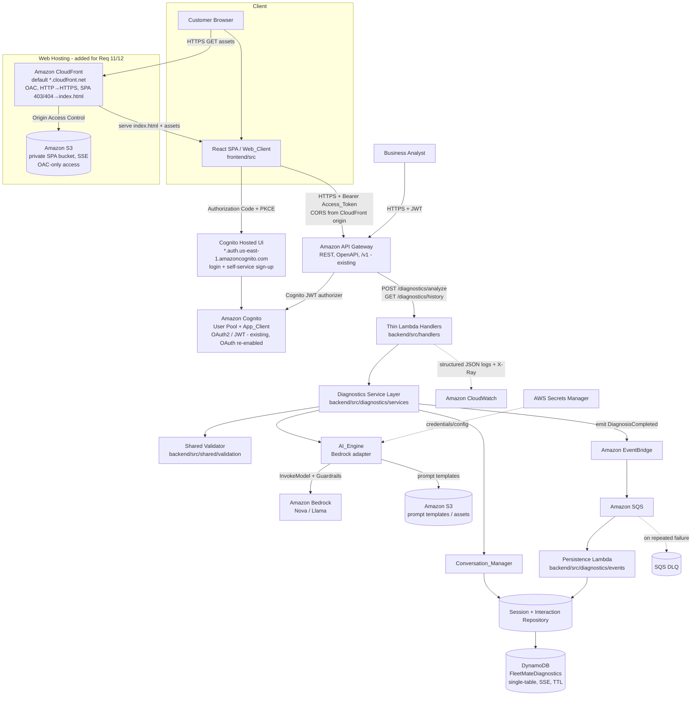
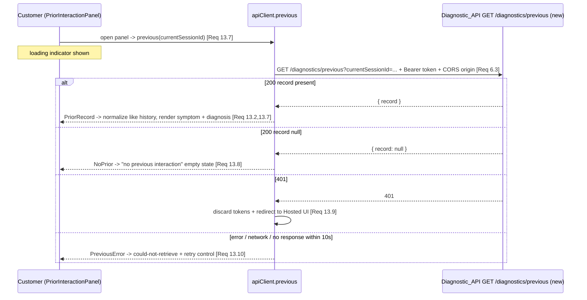
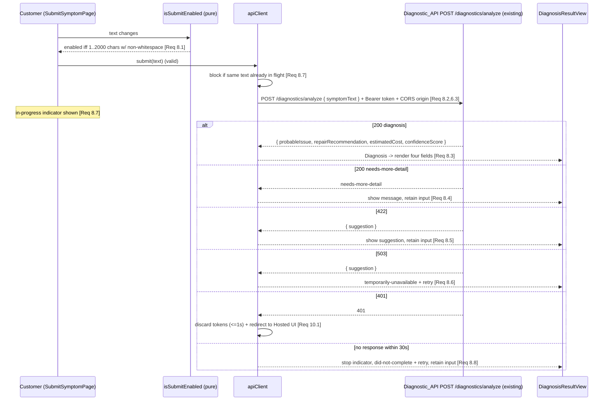

# Design Document

## Overview

The Vehicle Diagnostic Assistant (FleetMate) is an AI-powered, conversational feature that lets Customers describe vehicle symptoms in natural language and receive a structured diagnosis — a Probable_Issue, a Repair_Recommendation, an estimated cost, and a confidence score. The design is implemented on a serverless, event-driven AWS architecture per the project's technology standards (tech.md): Amazon API Gateway fronts thin AWS Lambda handlers (Python 3.12+, Boto3), Amazon Bedrock provides the AI model behind Bedrock Guardrails, Amazon DynamoDB stores session and interaction state, and persistence runs asynchronously via Amazon EventBridge/SQS so it never blocks the customer response.

A browser-based **Web_Client** (React single-page application) is layered on top of this backend as the Customer-facing surface. It authenticates Customers through the Amazon Cognito **Hosted UI** (OAuth 2.0 authorization-code flow with PKCE, self-service sign-up with email verification), then calls the **existing, already-deployed** Diagnostic_API (`POST /diagnostics/analyze`, `GET /diagnostics/history`) with the Cognito-issued token as a bearer credential. The SPA is hosted as static assets in a **private S3 bucket** served through **Amazon CloudFront** with Origin Access Control (OAC), using the default CloudFront domain and the Cognito-provided Hosted UI domain — no Route 53, no custom DNS, and no ACM/custom TLS certificate. The web tier (Requirements 6–12) is additive: it reuses the existing Cognito user pool and REST API unchanged and only adds the Hosted UI domain, the app-client OAuth settings, the S3 bucket, the CloudFront distribution, and the React app.

The feature decomposes into four cooperating backend logical components (below), plus the Web_Client front-end tier (described in the "Web User Interface" sections later in this document), each re-platformed onto managed AWS services:

- **Diagnostic_Assistant** — the orchestration boundary and public REST API. Exposed through API Gateway (`POST /diagnostics/analyze`, `GET /diagnostics/history`) backed by a thin Lambda handler that delegates to a diagnostics service layer. It enforces Cognito JWT authentication, performs fail-fast input validation before any AI or storage call, coordinates the other components, and shapes responses to the Customer.
- **Conversation_Manager** — owns Session lifecycle (creation, context carryover, interaction limits, idle timeout) and assembles chronological conversation context for the AI_Engine. Session state lives in the DynamoDB Diagnostic Sessions table, accessed through a repository.
- **AI_Engine** — a Bedrock adapter (Boto3 `bedrock-runtime`) that converts a Symptom_Description plus prior context into a structured Diagnostic_Result using reusable prompt templates and Bedrock Guardrails. It enforces the AI timeout, confidence scoring, and escalation handling. The Bedrock provider is isolated behind an interface so business logic never calls the SDK directly.
- **Interaction_Store** — asynchronous persistence plus authorized retrieval. On return of a diagnosis, the handler emits an event to EventBridge (fanned to an SQS queue); a separate persistence Lambda (with a DLQ) writes the Interaction_Record to DynamoDB so storage never blocks the customer response. Analyst date-range queries and Customer paginated history are served from DynamoDB through a repository with Cognito/RBAC authorization.

This separation keeps the Bedrock integration isolated behind a stable interface (so the model can change — Nova, Llama — without affecting conversation or storage logic), keeps Session rules in one place, and keeps all persistence and authorization concerns inside the store.

The design targets these quality constraints drawn from the requirements: a 5-second end-to-end response budget for symptom acceptance/acknowledgment (Req 1.5), a 30-second AI generation timeout (Req 2.6), a 2-second persistence budget (Req 4.1), a 2000-character symptom limit (Req 1, 2, 3), a 50-record-per-Session interaction limit (Req 3.4), a 30-minute idle Session timeout (Req 3.5), and a 50-record page size for history retrieval (Req 5.5).

### Design Decisions and Rationale

- **Serverless-first, API-first platform.** Every capability is exposed as a stateless REST endpoint through API Gateway with an OpenAPI specification and mandatory Cognito JWT authentication (tech.md API-First). Compute is AWS Lambda only; no EC2/ECS/Kubernetes. Rationale: aligns with the approved serverless stack and keeps the response path horizontally scalable.
- **Resource-style endpoint naming.** The API uses `/diagnostics/analyze`, `/diagnostics/history`, and `/repair-estimates` rather than verb-style names, per tech.md API naming conventions.
- **AI_Engine as a Bedrock adapter behind an interface.** The model is an external dependency with unpredictable latency and content. Isolating it behind a provider-agnostic interface allows timeout handling, confidence-based escalation, "insufficient information" handling, and model substitution (Nova ↔ Llama) without changing other components. Business logic never calls `bedrock-runtime` directly. Rationale: Req 2.5 and Req 2.6 require graceful handling of indeterminate and slow AI responses; tech.md prohibits direct external model APIs.
- **AI governance by design.** Every AI invocation applies Bedrock Guardrails (harmful-content filtering, prompt-injection prevention, PII detection, unsafe-repair-guidance blocking), performs input sanitization and prompt-payload validation using reusable prompt templates (never concatenating raw user input into prompts), emits audit logs, and runs escalation handling. Rationale: tech.md requires confidence scoring, Guardrails, audit logging, input validation, and escalation on every AI workflow.
- **Structured AI output, never raw model text.** The adapter parses Bedrock output into `{ probableIssue, repairRecommendation, estimatedCost, confidenceScore }`; raw model text is never returned to the Customer. Rationale: tech.md AI response requirements.
- **Confidence-driven escalation.** A diagnosis is escalated (rather than returned as authoritative) when `confidenceScore < 0.70`, when Guardrails flag an unsafe recommendation, or when the diagnosis is ambiguous. Rationale: tech.md confidence threshold.
- **Non-blocking, event-driven persistence.** The customer-facing diagnosis is synchronous, but the Interaction_Record is persisted asynchronously: the handler emits a `DiagnosisCompleted` event to EventBridge, which routes to an SQS queue consumed by a persistence Lambda. Storage failures never block or alter the customer response. Rationale: tech.md event-driven design + non-blocking storage; avoids Lambda-to-Lambda synchronous chaining and shared-database coupling.
- **Two timeout budgets.** The AI generation timeout (30s, Req 2.6) is intentionally longer than the acceptance/acknowledgment budget (5s, Req 1.5). These govern different operations and are satisfied independently.
- **Validation centralized at the boundary.** All length/emptiness checks live in a single shared validator (`backend/src/shared/validation/`) used by both the Diagnostic_Assistant handler (Req 1.2, 1.3, 2.4) and the Conversation_Manager (Req 3.2), ensuring identical fail-fast semantics across entry points, before any AI or storage call.
- **Store owns identity, time, and authorization.** Unique IDs (Req 4.2), UTC millisecond timestamps (Req 4.1), Cognito/RBAC authorization (Req 4.5, 5.4), and pagination (Req 5.5) are all enforced inside the Interaction_Store repository so callers cannot bypass them.
- **Single-table DynamoDB design.** Sessions and Interaction_Records share one partition-key-optimized table (`FleetMateDiagnostics`) with TTL for idle-session expiry, per tech.md database standards. SSE encryption is enabled.
- **Thin Lambda handlers.** Handlers (`backend/src/handlers/`) parse/authorize/validate and delegate to domain service layers (`backend/src/diagnostics/services/`); orchestration logic never lives in the handler.
- **Infrastructure as Code with environment isolation.** All resources are defined in AWS CloudFormation (`infrastructure/cloudformation/`) deployed to isolated `dev`, `qa`, and `prod` environments using blue/green or canary strategy with automatic rollback.
- **Hosted-UI authentication, no custom login form.** Authentication uses the Cognito Hosted UI with the OAuth 2.0 authorization-code grant plus PKCE; the Web_Client never handles raw credentials and never implements a login form. Rationale: tech.md mandates Cognito + OAuth2/JWT and prohibits custom authentication systems (Req 6, 7).
- **Private S3 + CloudFront with OAC.** The compiled SPA lives in a private S3 bucket (SSE enabled) reachable only through a CloudFront distribution using Origin Access Control; direct-to-origin requests are denied. CloudFront redirects HTTP→HTTPS and maps 403/404 to `index.html` (HTTP 200) for SPA client-side routing. Rationale: serverless static hosting over HTTPS with least-privilege origin access (Req 11).
- **Default domains only — no DNS/cert management.** The deployment uses the default CloudFront domain (`*.cloudfront.net`) and the Cognito domain (`*.auth.us-east-1.amazoncognito.com`); no Route 53 records, no custom DNS, no ACM/custom certificate. Rationale: explicit simplicity constraint (Req 12).
- **Re-enable OAuth on the existing app client (deferred callback wiring).** The existing Cognito User Pool App_Client currently has the hosted-UI OAuth flow disabled (it was removed during an earlier backend deploy because callback URLs are required). The design re-enables `AllowedOAuthFlows=code` with scopes `openid email profile` and `SupportedIdentityProviders=COGNITO`, and adds a Cognito UserPoolDomain. Because the CloudFront callback/logout URLs are only known after the distribution exists, the design resolves this chicken-and-egg ordering by wiring the callback/logout URLs through a stack parameter populated from the CloudFront distribution's domain within the same template (CloudFormation resolves `!Sub`/`!GetAtt` ordering via resource dependencies), with a documented fallback of a second `update-stack` pass when the distribution domain must be fed back as a parameter. Rationale: reuse existing infra, add OAuth config safely (Req 6.6, 12.4).
- **Reuse existing user pool and REST API; add only the web tier.** The user pool and the `/v1` REST API are unchanged; only the Hosted UI domain, app-client OAuth settings, S3 bucket, CloudFront distribution, and React app are added. Rationale: the backend is already built and deployed.
- **CORS for the CloudFront origin.** Because the SPA calls `POST /diagnostics/analyze` and `GET /diagnostics/history` from the browser (the CloudFront origin), API Gateway and/or the Lambda responses must return CORS headers (`Access-Control-Allow-Origin` = the CloudFront HTTPS origin, `Access-Control-Allow-Headers: Authorization,Content-Type`, `Access-Control-Allow-Methods: POST,GET,OPTIONS`) and handle preflight `OPTIONS`. Rationale: cross-origin browser calls to the existing API (Req 8, 9).
- **Runtime config via a generated, non-secret config file.** The SPA receives its runtime configuration (API base URL `https://<api-id>.execute-api.us-east-1.amazonaws.com/v1`, Cognito domain, user pool id, app client id, redirect/logout URIs) through a generated `config.json` (or `window.__FLEETMATE_CONFIG__`) emitted at deploy time from CloudFormation outputs and uploaded alongside the static assets, or injected as build-time environment variables. These are all public identifiers — no secrets are embedded in the client (tech.md: never hardcode secrets). Rationale: decouples the SPA build from environment-specific endpoints (Req 6, 8, 9).

## Architecture



### Request Flow: Submit Symptom and Generate Diagnosis

```mermaid
sequenceDiagram
    participant C as Customer (React)
    participant GW as API Gateway + Cognito
    participant H as Lambda Handler
    participant SVC as Diagnostics Service
    participant CM as Conversation_Manager (DynamoDB repo)
    participant AE as AI_Engine (Bedrock adapter)
    participant EB as EventBridge -> SQS
    participant PL as Persistence Lambda -> DynamoDB

    C->>GW: POST /diagnostics/analyze (JWT, symptomText, sessionId?)
    GW->>GW: validate JWT (Cognito authorizer)
    GW->>H: invoke (claims, body)
    H->>SVC: analyze(customerId, sessionId?, symptomText)
    SVC->>SVC: validate(symptomText)  [fail-fast, before AI/storage]
    alt invalid (empty/whitespace/>2000)
        SVC-->>H: Rejection(EMPTY|TOO_LONG)
        H-->>C: 422 { code, suggestion, timestamp } (session preserved, nothing recorded)
    else valid
        SVC->>CM: ensureSession(customerId, sessionId?)
        CM->>CM: create session if none / check active + 50-limit (DynamoDB)
        alt session closed or limit reached
            CM-->>SVC: Error(SESSION_CLOSED | LIMIT_REACHED)
            SVC-->>H: error
            H-->>C: 422/409 { code, suggestion, timestamp }
        else session usable
            CM-->>SVC: sessionId + ordered prior context
            SVC->>AE: generate(sanitized symptomText, context) [30s timeout + Guardrails]
            alt AI timeout / failure
                AE-->>SVC: Timeout | AiError
                SVC-->>H: Failure(AI_TIMEOUT)
                H-->>C: 503 { suggestion: retry, timestamp }
            else AI responded
                AE-->>SVC: Diagnostic_Result { probableIssue, repairRecommendation, estimatedCost, confidenceScore } | InsufficientInfo
                SVC->>SVC: escalation check (confidence < 0.70 / unsafe / ambiguous)
                SVC->>EB: emit DiagnosisCompleted (Interaction_Record draft)
                SVC->>CM: append Interaction_Record to session (DynamoDB)
                SVC-->>H: DiagnosticResponse
                H-->>C: 200 { probableIssue, repairRecommendation, estimatedCost, confidenceScore, escalated?, timestamp }
                Note over EB,PL: asynchronous, off the response path
                EB->>PL: deliver via SQS
                PL->>PL: persist Interaction_Record (<=2s target), retry once; DLQ on repeated failure
            end
        end
    end
```

### Layering and Dependency Direction

The components form a strict dependency direction: the thin handler depends on the diagnostics service layer; the service depends on the Conversation_Manager, AI_Engine, and Interaction_Store; those three do not depend on one another. The AI_Engine depends only on the Bedrock adapter interface; the repositories depend only on DynamoDB. This keeps each component independently testable with the AWS dependencies (Bedrock, DynamoDB, EventBridge/SQS) mocked.

### Cross-Cutting AWS Concerns

- **Authentication/Authorization:** API Gateway uses a Cognito JWT authorizer; RBAC claims distinguish Customer vs analyst principals. Least-privilege IAM roles per Lambda.
- **AI governance:** Bedrock Guardrails attached to every `InvokeModel` call; prompt templates stored separately from business logic (`backend/src/diagnostics/prompts/`) and loaded (optionally from S3); user input sanitized and prompt payloads validated before invocation; audit records emitted for every AI call.
- **Reliability:** exponential backoff with jitter on Bedrock and DynamoDB calls; a circuit breaker guards the Bedrock dependency; the async persistence Lambda and its SQS consumer each have a DLQ.
- **Observability:** structured JSON logs (`correlationId`, `service`, `level`, `message`) via a shared logging utility (`backend/src/shared/logging/`); AWS X-Ray tracing; CloudWatch alarms for Lambda error rate, API latency, Bedrock response latency, token-usage spikes, and confidence-score degradation.
- **Security:** TLS for all APIs, DynamoDB SSE, S3 SSE, and AWS Secrets Manager for any credentials/config (no hardcoded secrets).
- **Deployment:** CloudFormation stacks per environment (`dev`/`qa`/`prod`), blue/green or canary with automatic rollback on failed health checks, elevated error rate, or critical alarms.

## Components and Interfaces

All public interactions are REST, JSON, stateless, and JWT-authenticated through API Gateway + Cognito. Interfaces below are expressed language-neutrally; the implementation is Python 3.12+ with Boto3.

### Diagnostic_Assistant (API Gateway + thin Lambda handler + diagnostics service)

REST endpoints (OpenAPI-specified):

```text
POST /diagnostics/analyze
  Auth: Cognito JWT (Customer)
  Body: { symptomText: string, sessionId?: string, vehicle?: { make?, model?, year? } }
  200:  { sessionId, probableIssue, repairRecommendation, estimatedCost, confidenceScore, escalated: bool, timestamp }
  422:  { code: "EMPTY" | "TOO_LONG" | "LIMIT_REACHED" | "SESSION_CLOSED", suggestion, timestamp }
  503:  { suggestion, timestamp }   // AI timeout / Bedrock failure

GET /diagnostics/history?sessionId=...&pageToken=...
  Auth: Cognito JWT (Customer, owner only)
  200:  { records: InteractionRecord[<=50], nextPageToken?, timestamp }
  400:  invalid request (e.g., missing/invalid params)
  404:  { suggestion, timestamp }   // unknown session
  403:  { suggestion, timestamp }   // not owner

GET /repair-estimates/{sessionId}        // analyst/reporting view (date-range variant via query params)
  Auth: Cognito JWT (analyst RBAC)
  200:  { records: InteractionRecord[], timestamp }
  403 / 400 as appropriate
```

Responsibilities:
- Thin handler: validate JWT (via Cognito authorizer), parse request, attach `correlationId`, delegate to the diagnostics service.
- Diagnostics service: validate every Symptom_Description via the shared validator before any AI/storage call (Req 1.2, 1.3, 2.4); coordinate Session resolution, AI generation, escalation, and asynchronous persistence; enforce the acceptance/acknowledgment response contract (Req 1.5); return the structured diagnosis or the appropriate error/insufficient-info indication (Req 2.3, 2.5, 2.6).

Service-level interface:

```text
analyze(customerId, sessionId?, symptomText, vehicle?) -> SubmissionResult
  SubmissionResult = DiagnosticResponse { sessionId, result: Diagnostic_Result, escalated }
                   | Acknowledgment     { sessionId, accepted: true }
                   | Rejection          { reason: EMPTY | TOO_LONG | SESSION_CLOSED | LIMIT_REACHED }
                   | Failure            { reason: AI_TIMEOUT | AI_ERROR }
```

### Shared Validator (`backend/src/shared/validation/`)

A pure validation function used by both the diagnostics service and the Conversation_Manager so validation semantics are identical everywhere and run fail-fast before any AI or storage call.

```text
validateSymptom(text) -> Valid | Invalid(EMPTY) | Invalid(TOO_LONG)
  EMPTY     : text is null, "", or contains only whitespace
  TOO_LONG  : length exceeds 2000 characters
  Valid     : 1..2000 characters with at least one non-whitespace char
```

Rationale: centralizing this logic guarantees Req 1.2/1.3, Req 2.4, and Req 3.2 reject identically.

### Conversation_Manager (DynamoDB-backed, via repository)

Responsibilities:
- Create a new Session with a unique identifier (UUID v4) when none is active (Req 1.4).
- Maintain the ordered sequence of Interaction_Records per Session in ascending chronological order (Req 3.3).
- Supply all prior Interaction_Records of the active Session as ascending-ordered context to the AI_Engine (Req 3.1).
- Enforce the 50-interaction limit per Session (Req 3.4).
- Enforce the 30-minute idle timeout and reject submissions to closed Sessions (Req 3.5).
- Validate follow-up submissions (delegating to the shared validator) and preserve context unchanged on rejection (Req 3.2).

Interface (implemented over a DynamoDB repository, `backend/src/diagnostics/repositories/`):

```text
ensureSession(customerId, sessionId?) -> SessionHandle | Error(SESSION_CLOSED) | Error(LIMIT_REACHED)
getContext(sessionId) -> ordered list[Interaction_Record]   // ascending by createdAt
appendInteraction(sessionId, Interaction_Record) -> void
isActive(sessionId, now) -> bool                            // false if idle >= 30 min
```

Idle timeout is evaluated against `lastSubmissionAt`; a Session with no submission for 30 continuous minutes is considered closed (Req 3.5). DynamoDB TTL is set on the session item to expire idle sessions, with the application-level `lastSubmissionAt` check as the authoritative gate so the property holds precisely regardless of TTL deletion lag.

### AI_Engine (Amazon Bedrock adapter)

Responsibilities:
- Convert a sanitized Symptom_Description plus ordered prior context into a Diagnostic_Result via Amazon Bedrock (`bedrock-runtime` InvokeModel), using approved models (Nova or Llama) (Req 2.1).
- Build the prompt from reusable templates (stored separately in `backend/src/diagnostics/prompts/`), never concatenating raw user input into the prompt; validate the prompt payload before invocation.
- Apply Bedrock Guardrails on every invocation (harmful content, prompt injection, PII detection, unsafe repair guidance).
- Parse model output into a structured result `{ probableIssue, repairRecommendation, estimatedCost, confidenceScore }` — never return raw model text (Req 2.2, 2.3).
- Produce exactly one Probable_Issue and exactly one Repair_Recommendation on success (Req 2.2).
- Signal "insufficient information" when it cannot determine a Probable_Issue (Req 2.5).
- Enforce the 30-second generation timeout and signal timeout to the caller (Req 2.6).
- Compute/attach `confidenceScore` and support escalation decisions by the service layer (confidence < 0.70, unsafe, ambiguous).

Provider-agnostic interface (business logic depends on this, not on Boto3):

```text
generate(symptomText, context) -> Diagnostic_Result | InsufficientInfo | Timeout | AiError
  // Diagnostic_Result = { probableIssue: non-empty, repairRecommendation: non-empty,
  //                       estimatedCost: string, confidenceScore: 0.0..1.0 }
  // InsufficientInfo  = { probableIssue: none, needsMoreDetail: true, message }
  // Timeout           = produced if generation exceeds 30 seconds
  // AiError           = Guardrail block or model/invocation failure (mapped to 503)
```

A `BedrockAiEngine` concrete adapter implements this interface using `bedrock-runtime`; the Session logic and service layer never import Boto3 directly. This keeps the AI_Engine a replaceable adapter.

### Interaction_Store (asynchronous persistence + DynamoDB repository)

The store has two sides:

**Write side (asynchronous, event-driven):** the diagnostics service emits a `DiagnosisCompleted` event to EventBridge carrying the Interaction_Record draft. EventBridge routes it to an SQS queue consumed by a dedicated persistence Lambda, which writes to DynamoDB. The persistence Lambda retries a failed write once within 5 seconds; on repeated failure the message lands in a DLQ and the failure is logged with the Session id and timestamp. Because this path is off the response thread, storage failures never block or alter the customer response.

**Read side (synchronous retrieval):** served directly from DynamoDB through the repository with Cognito/RBAC authorization.

```text
// write side (invoked by the persistence Lambda, not the response path)
persist(Interaction_Record draft) -> recordId | Error(PERSIST_FAILED)

// read side (invoked by GET /diagnostics/history and /repair-estimates)
queryByDateRange(principal, start, end) -> ordered list | Error(ACCESS_DENIED) | Error(INVALID_RANGE)
getSessionHistory(principal, sessionId, pageToken?) -> Page | Error(NOT_FOUND) | Error(ACCESS_DENIED)
  Page = { records: ordered list (<= 50), nextPageToken? }
```

Responsibilities:
- Persist Interaction_Records with UTC millisecond timestamps and a unique identifier (UUID v4) each, targeting the 2-second budget on the write path (Req 4.1, 4.2).
- On persistence failure, write no partial record, log with Session id and timestamp, return an error / route to DLQ (Req 4.3).
- Serve authorized analyst date-range queries in ascending timestamp order (Req 4.4), reject unauthorized analysts (Req 4.5), and reject inverted date ranges (Req 4.6).
- Serve Customer Session-history queries in ascending timestamp order within 2 seconds (Req 5.1), return empty sets for empty-but-valid Sessions (Req 5.2), 404 on unknown Sessions (Req 5.3), reject unauthorized access (Req 5.4), and paginate at 50 records per page (Req 5.5).

## Most-Recent Prior Interaction (Requirement 13)

This section is **additive** to the already-built-and-deployed backend. It adds one owner-scoped read capability — resolving a Customer's single Most_Recent_Prior_Interaction from before the Current_Session — layered on the existing Interaction_Store read side, the existing thin-handler + typed-outcome + structured-logging + CORS patterns, and the existing Cognito ID-token authorizer. No existing diagnostics/session/store write logic changes; the only write-path change is that new Interaction_Records begin carrying the `customerId` and GSI2 key attributes needed to make this cross-session, owner-scoped query possible (see Data Models → Prior-Interaction Access Pattern and the backfill/migration note).

### Prior-Interaction read flow

```mermaid
sequenceDiagram
    participant C as Customer (React PriorInteractionPanel)
    participant GW as API Gateway + Cognito ID-token authorizer
    participant H as Thin Lambda Handler (previous)
    participant SVC as Diagnostics Service (read side)
    participant REPO as Interaction Repository (GSI2)
    participant DDB as DynamoDB FleetMateDiagnostics (GSI2)

    C->>GW: GET /diagnostics/previous?currentSessionId=... (ID token)
    GW->>GW: validate ID token (Cognito authorizer); 401/403 handled by gateway responses
    GW->>H: invoke (claims incl. sub, query params)
    H->>H: attach correlationId; customerId := claims.sub (NEVER client-supplied)
    alt currentSessionId missing/blank
        H-->>C: 400 { code: "MISSING_CURRENT_SESSION", suggestion, timestamp }
    else currentSessionId present
        H->>SVC: get_most_recent_prior_interaction(customerId, currentSessionId)
        SVC->>SVC: owner-scope enforced from sub (fail closed) before any read
        SVC->>REPO: query GSI2 (GSI2PK=CUSTOMER#{customerId}), ScanIndexForward=false, Limit=2
        REPO->>DDB: Query newest-first, bounded page
        DDB-->>REPO: up to N newest records for this customer
        REPO->>REPO: drop records whose sessionId == currentSessionId; take first remaining
        REPO-->>SVC: InteractionRecord | None
        alt a prior interaction exists
            SVC-->>H: InteractionRecord (same shape as history)
            H-->>C: 200 { record: InteractionRecord, timestamp }
        else none outside current session
            SVC-->>H: None
            H-->>C: 200 { record: null, timestamp }
        end
    end
    Note over GW,C: 401 (expired/invalid token) returned by authorizer + gateway response with CORS headers
```

### New endpoint (`GET /diagnostics/previous`)

Added to the existing API Gateway REST API under the same `/v1` stage, authorized by the **same Cognito ID-token authorizer** as the other owner-scoped endpoints. The new method, its unauthenticated `OPTIONS` preflight, and the CORS treatment mirror the existing `GET /diagnostics/history` method exactly; the method must be added to API Gateway and the stage redeployed.

```text
GET /diagnostics/previous?currentSessionId=...
  Auth: Cognito ID token (Customer, owner only — customerId resolved from the `sub` claim)
  200:  { record: InteractionRecord | null, timestamp }   // same InteractionRecord shape as history
  400:  { code: "MISSING_CURRENT_SESSION", suggestion, timestamp }   // currentSessionId omitted/blank (Req 13.6)
  401:  (authorizer/gateway response) invalid/expired token — consumed by Web_Client (Req 13.9)
  403:  (authorizer/gateway response) not an authorized Customer principal

OPTIONS /diagnostics/previous
  Auth: none (unauthenticated preflight)
  200:  CORS headers: Access-Control-Allow-Origin = WEB_APP_ORIGIN,
        Access-Control-Allow-Headers: Authorization,Content-Type,
        Access-Control-Allow-Methods: GET,OPTIONS
```

Handler responsibilities (thin, `backend/src/handlers/`):
- Validate the ID token via the Cognito authorizer (gateway-level), attach a `correlationId`, emit structured JSON logs.
- Resolve `customerId` **exclusively** from the validated token's `sub` claim — never from a query-string, header, or body value (Req 13.4 fail-closed owner-scoping).
- Require `currentSessionId`; if omitted or blank, return `400 { code: "MISSING_CURRENT_SESSION", ... }` before any read (Req 13.6).
- Delegate to the diagnostics service read side; map the result to the same `InteractionRecord` response shape used by history (Req 13.2), returning `{ record: null }` when the service resolves no prior interaction (Req 13.5).
- Echo the `WEB_APP_ORIGIN` CORS header on its responses, consistent with the existing handlers. 401/403 are produced by the authorizer and API Gateway gateway responses (which already carry CORS headers), consumed by the Web_Client (Req 13.9).

### Service / repository interface (read side)

The capability is added to the Interaction_Store **read side**, keeping Boto3 isolated in the repository, returning typed outcomes, and enforcing owner-scoping in the service layer **before** any read (fail closed).

```text
// service (owner-scoping enforced here, before any read)
get_most_recent_prior_interaction(customerId, currentSessionId) -> InteractionRecord | None
  // customerId is always the authenticated Cognito `sub`; currentSessionId is required and non-blank
  // returns the single Most_Recent_Prior_Interaction, or None when the Customer owns no record
  // outside currentSessionId (Req 13.1, 13.3, 13.5)

// repository (Boto3 isolated here; queries GSI2 newest-first with current-session exclusion)
query_most_recent_prior(customerId, currentSessionId, limit=2) -> InteractionRecord | None
  // Query GSI2PK = CUSTOMER#{customerId}, ScanIndexForward=false, Limit=limit
  // skip any returned record whose sessionId == currentSessionId; return the first remaining, else None
```

Selection semantics (Req 13.1, 13.3): records are ordered newest-first by the GSI2 sort key `{createdAt}#{recordId}`, so the first record whose `sessionId` differs from `currentSessionId` is exactly the Prior_Interaction with the latest `createdAt`, ties broken by the greater `recordId`. Owner-scoping (Req 13.4): because the partition key is `CUSTOMER#{customerId}` and `customerId` is the authenticated `sub`, the query can only ever read the authenticated Customer's own records; another Customer's records are physically in a different GSI2 partition and are never read. Empty result (Req 13.5): when no returned record falls outside `currentSessionId`, the service returns `None` and the handler returns `{ record: null }`.

### Web_Client prior-interaction panel

A new SPA component, **distinct from `SessionHistoryPage`**, rendered in the authenticated view (Req 13.7). It is described in the Web User Interface section below (new page `PriorInteractionPanel.tsx` and a new API-client method `previous(...)`).

## Web User Interface (Requirements 6–12)

This section describes the browser tier added on top of the existing backend. It introduces no changes to the diagnostics/session/store logic; it consumes the existing REST API and adds hosting, authentication wiring, and the React application. All components are TypeScript (strict) React per the frontend steering standard.

### Frontend Project Structure (`frontend/`)

Consistent with structure.md (group by concern, keep components thin, isolate services and config):

```text
frontend/
├── public/
│   └── config.json                 # generated runtime config (non-secret) — see Runtime Configuration
├── src/
│   ├── auth/                        # Auth module: Hosted UI redirect, PKCE, token store, guards
│   │   ├── pkce.ts                  # generateVerifier(), deriveChallenge(verifier)
│   │   ├── authClient.ts            # buildLoginUrl(), handleCallback(), logout(), exchangeCode()
│   │   ├── tokenStore.ts            # in-memory/sessionStorage token store, isTokenValid(expiry, now)
│   │   └── routeGuard.ts            # requireAuth(authState, route) -> ALLOW | REDIRECT_TO_HOSTED_UI
│   ├── services/
│   │   └── apiClient.ts             # bearer injection, request builders, 401/403/422/503 mapping
│   ├── pages/
│   │   ├── LoginLandingPage.tsx     # unauthenticated landing + "Log in / Sign up" (Req 6.1, 6.5)
│   │   ├── CallbackPage.tsx         # consumes ?code / ?error, triggers exchange (Req 6.2, 6.4, 6.7)
│   │   ├── SubmitSymptomPage.tsx    # symptom input + submit gating (Req 8)
│   │   ├── DiagnosisResultView.tsx  # renders result fields (Req 8.3, 8.4)
│   │   ├── SessionHistoryPage.tsx   # ordered + paginated history (Req 9)
│   │   └── PriorInteractionPanel.tsx # single most-recent prior interaction, distinct from history (Req 13.7-13.10)
│   ├── components/                  # presentational pieces (input, result card, history row, retry)
│   ├── config/
│   │   └── runtimeConfig.ts         # loads config.json / window.__FLEETMATE_CONFIG__
│   └── utils/
└── package.json
```

### Runtime Configuration

The SPA needs environment-specific, **public** identifiers at runtime: the API base URL (`https://<api-id>.execute-api.us-east-1.amazonaws.com/v1`), the Cognito domain (`https://<prefix>.auth.us-east-1.amazoncognito.com`), the user pool id, the app client id, and the redirect/logout URIs (the CloudFront origin). These reach the SPA through a generated `config.json` placed next to the static assets (loaded at startup by `config/runtimeConfig.ts`), produced at deploy time from CloudFormation stack outputs; build-time environment variables are an equivalent alternative. None of these values are secrets, so nothing confidential is embedded in the client (tech.md: never hardcode secrets, no `.env` committed). This keeps a single SPA build portable across `dev`/`qa`/`prod` by swapping only `config.json`.

### Web_Client Components and Interfaces

All interfaces are expressed language-neutrally; the implementation is TypeScript React.

#### Auth module (`src/auth/`)

Owns the Hosted UI authorization-code + PKCE flow, token lifecycle, and route guarding. Business/UI code depends on this module, never on OAuth details directly.

```text
// PKCE (pure)
generateVerifier() -> string                      // high-entropy random
deriveChallenge(verifier) -> string               // base64url(SHA256(verifier))

// Login / callback / logout
buildLoginUrl(config, state, challenge) -> url    // Hosted UI authorize endpoint, code flow, PKCE
handleCallback(callbackParams, pendingVerifier) -> AuthOutcome
  AuthOutcome = CodeReady { code, verifier }       // ?code present, verifier matches pending
              | AuthError { message, retry: true } // ?error present (Req 6.4)
exchangeCode(code, verifier, config) -> Tokens | ExchangeFailed   // network; 10s budget (Req 6.2, 6.7)
logout(config) -> logoutRedirectUrl                // discards tokens, returns Hosted UI logout URL (Req 10.2)

// Token store + validity (pure predicate)
isTokenValid(expiryEpoch, nowEpoch) -> bool        // true iff expiryEpoch > nowEpoch (Req 10.5)
clearTokens() -> void                              // store empty afterward (Req 10.1/10.2/10.3/10.6)

// Route guard (pure)
requireAuth(authState, route) -> ALLOW | REDIRECT_TO_HOSTED_UI
  // REDIRECT_TO_HOSTED_UI for protected routes whenever no valid ID_Token (Req 6.1, 6.5)
```

Token storage policy: the ID_Token and Access_Token are held in memory and/or `sessionStorage` (session-scoped), retained only for the authenticated browser session and discarded when the session ends (Req 10.4). After any invalidating event — a 401 from the API (Req 10.1), logout (Req 10.2, 10.3), or a detected expiry (Req 10.5) — the store is emptied and no subsequent request carries a token even if a discard operation reports failure (Req 10.6).

#### API client (`src/services/apiClient.ts`)

Builds authenticated requests to the existing Diagnostic_API and maps responses to UI outcomes.

```text
analyze(symptomText, sessionId?) -> AnalyzeOutcome      // POST /diagnostics/analyze (Req 8.2)
history(sessionId, pageToken?) -> HistoryOutcome        // GET  /diagnostics/history (Req 9.1)
previous(currentSessionId) -> PreviousOutcome           // GET  /diagnostics/previous (Req 13.7)

// Every outgoing request carries: Authorization: Bearer <Access_Token> (Req 6.3)

AnalyzeOutcome = Diagnosis { probableIssue, repairRecommendation, estimatedCost, confidenceScore }  // 200 (Req 8.3)
               | NeedsMoreDetail { message }            // 200 needs-more-detail (Req 8.4)
               | Rejected { suggestion }                // 422 (Req 8.5)
               | Unavailable { message, retry: true }   // 503 (Req 8.6)
               | Unauthorized                           // 401 -> triggers token discard + re-auth (Req 10.1)

HistoryOutcome = Records { items: InteractionRecord[<=50], nextPageToken? }  // 200 (Req 9.2, 9.6)
               | Empty                                  // 200 empty set (Req 9.3)
               | Forbidden                              // 403 not owner (Req 9.4)
               | NotFound                               // 404 unknown session (maps from backend 5.3)
               | RetrievalError { retriesRemaining }    // service/network/timeout, cap 3 (Req 9.5)

PreviousOutcome = PriorRecord { record: InteractionRecord }  // 200 record present (Req 13.2)
                | NoPrior                                     // 200 { record: null } (Req 13.8)
                | Unauthorized                                // 401 -> token discard + re-auth (Req 13.9)
                | PreviousError { message, retry: true }      // service/network/timeout (Req 13.10)
```

Response → UI-state mapping is a pure function of the HTTP status/response shape; it never surfaces internal/provider error detail, consistent with the backend error-handling contract.

#### Submit-Symptom view (`pages/SubmitSymptomPage.tsx`)

- Presents a symptom input and submit control while the Customer holds a valid Access_Token (Req 8.1).
- `isSubmitEnabled(text)` is a pure gate: enabled **iff** `text` has 1–2000 characters with at least one non-whitespace character; disabled for empty, whitespace-only, or >2000 (Req 8.1) — mirroring the backend shared validator so the client fails fast before calling the API.
- On submit of valid text, calls `analyze(...)`, shows an in-progress indicator, and blocks a duplicate submission of the same text while a request is in flight (Req 8.7).
- If no response arrives within 30 seconds, it stops the in-progress indicator, shows a did-not-complete message with retry, and retains the submitted text (Req 8.8).

#### Diagnosis-result view (`pages/DiagnosisResultView.tsx`)

- For a `Diagnosis` outcome, renders the Probable_Issue, Repair_Recommendation, estimated cost, and confidence score (Req 8.3).
- For `NeedsMoreDetail`, shows the needs-more-detail message and retains the submitted symptom for editing (Req 8.4).
- For `Rejected` (422), shows the returned suggestion and retains the symptom for correction (Req 8.5); for `Unavailable` (503), shows the temporarily-unavailable message and a retry control (Req 8.6).

#### Session-history view (`pages/SessionHistoryPage.tsx`)

- On open, requests `GET /diagnostics/history` with the Customer's Session identifier (Req 9.1).
- Renders records ascending by `createdAt`, tie-broken by `recordId` (Req 9.2).
- Shows a no-past-interactions message for an empty set (Req 9.3).
- On 403, shows a not-authorized message and retains any previously displayed records (Req 9.4).
- On service/network error or no response within 10 seconds, shows a could-not-retrieve message with a retry control permitting up to 3 attempts (Req 9.5).
- When the response carries a `nextPageToken`, presents a next-page control that requests the next page of up to 50 records (Req 9.6).

#### Prior-interaction panel (`pages/PriorInteractionPanel.tsx`) — Requirement 13 (web)

A panel **visually and structurally distinct from `SessionHistoryPage`** that shows the Customer's single most-recent interaction from before the Current_Session. It consumes the persisted current `sessionId` (the same identifier the Submit/History views use) and the new `previous(...)` API-client method.

- On open (authenticated view), it requests `GET /diagnostics/previous` with the persisted Current_Session identifier (Req 13.7). It shows a loading state while the request is in flight.
- For a `PriorRecord` outcome, it normalizes the returned `InteractionRecord` the **same way history records are normalized** (flattening `symptomDescription` + nested `result` into a flat view-model with `probableIssue`, `repairRecommendation`, estimated cost, and confidence score) and displays the prior Symptom_Description and Diagnostic_Result (Req 13.2, 13.7).
- For a `NoPrior` outcome (`{ record: null }`), it displays an empty-state message stating that no previous interaction exists (Req 13.8).
- On `Unauthorized` (401), it discards the stored ID_Token and Access_Token and redirects the Customer to the Hosted_UI to re-authenticate, reusing the shared 401 handling in the API client/auth module (Req 13.9).
- On `PreviousError` (service error, network failure, or no response within 10 seconds), it displays a could-not-retrieve-previous-interaction message and presents a retry control that re-issues the request (Req 13.10).

The record-normalization logic is shared with the history view so both render identical `InteractionRecord` shapes (Req 13.2), and the panel is mounted separately from the history list so the two views remain distinct (Req 13.7).

#### Prior-interaction fetch flow



#### Login/landing view (`pages/LoginLandingPage.tsx`, `pages/CallbackPage.tsx`)

- The landing page is the unauthenticated view with a control that initiates login/sign-up by redirecting to the Hosted UI via `buildLoginUrl(...)` (Req 6.1, 6.5, 7.1).
- The callback page consumes the Hosted UI redirect: on `?code` it validates the PKCE verifier and exchanges the code for tokens (Req 6.2); on `?error` it shows a login-did-not-complete message with retry and stores no token (Req 6.4); on exchange failure/timeout it discards any partial token and offers retry (Req 6.7).

### OAuth Login Flow (Hosted UI, authorization code + PKCE)

```mermaid
sequenceDiagram
    participant B as Customer Browser (SPA)
    participant CF as CloudFront (SPA assets)
    participant HUI as Cognito Hosted UI
    participant TK as Cognito /oauth2/token
    participant API as Diagnostic_API (existing)

    B->>CF: GET / (load SPA)
    CF-->>B: index.html + assets (HTTPS)
    B->>B: requireAuth(protected route) -> REDIRECT (no valid ID_Token) [Req 6.1,6.5]
    B->>B: verifier = generateVerifier(); challenge = deriveChallenge(verifier); store verifier
    B->>HUI: GET /authorize?response_type=code&client_id=...&scope=openid email profile&redirect_uri=CloudFront&code_challenge=challenge&code_challenge_method=S256
    Note over HUI: Customer logs in or self-service signs up + verifies email [Req 7]
    alt authentication error
        HUI-->>B: redirect to callback ?error=...
        B->>B: handleCallback -> AuthError { retry } ; no token stored [Req 6.4]
    else authorization code returned
        HUI-->>B: redirect to callback ?code=AUTH_CODE
        B->>B: handleCallback -> CodeReady { code, verifier (matches pending) }
        B->>TK: POST /oauth2/token (grant=authorization_code, code, code_verifier, redirect_uri)  [<=10s, Req 6.2]
        alt exchange ok
            TK-->>B: { id_token, access_token, expires_in }
            B->>B: store tokens (session-scoped) [Req 10.4]
            B->>API: subsequent calls with Authorization: Bearer access_token [Req 6.3]
        else exchange error or >10s
            TK-->>B: error / timeout
            B->>B: discard partial token; AuthError { retry } [Req 6.7]
        end
    end
```

### Symptom-Submit Flow (authenticated call to existing API)



### Infrastructure as Code (added to the existing stack)

The web-tier resources are added to the existing CloudFormation/SAM stack (`backend/template.yaml`, or a companion/nested template under `infrastructure/cloudformation/`), preserving `dev`/`qa`/`prod` isolation and the no-custom-DNS/no-cert constraint. The existing user pool and REST API are referenced, not recreated.

| Resource | Type | Key configuration | Requirement |
|---|---|---|---|
| SPA bucket | `AWS::S3::Bucket` | Private (BlockPublicAccess all true), SSE enabled, no website hosting; policy grants read only to the CloudFront distribution via OAC | 11.1, 11.4 |
| CloudFront distribution | `AWS::CloudFront::Distribution` | Default `*.cloudfront.net` domain (no aliases/ACM), `DefaultRootObject: index.html`, OAC to the S3 origin, `ViewerProtocolPolicy: redirect-to-https`, custom error responses 403→`/index.html` (200) and 404→`/index.html` (200) for SPA routing | 11.2, 11.3, 11.5, 12.1 |
| Origin Access Control | `AWS::CloudFront::OriginAccessControl` | Signs origin requests so only CloudFront can read the bucket | 11.4 |
| Cognito domain | `AWS::Cognito::UserPoolDomain` | `Domain: <prefix>` on the existing user pool → `*.auth.us-east-1.amazoncognito.com` Hosted UI | 12.2 |
| App client (update existing) | `AWS::Cognito::UserPoolClient` | `AllowedOAuthFlows: [code]`, `AllowedOAuthFlowsUserPoolClient: true`, `AllowedOAuthScopes: [openid, email, profile]`, `SupportedIdentityProviders: [COGNITO]`, `CallbackURLs`/`LogoutURLs` = CloudFront HTTPS origin, no client secret (public SPA client) | 6.6, 12.4 |
| API CORS | API Gateway method/OPTIONS + Lambda response headers | Allow the CloudFront origin, `Authorization,Content-Type` headers, `POST,GET,OPTIONS` methods; preflight handled | 8, 9 |
| GSI2 on `FleetMateDiagnostics` (update existing) | `AWS::DynamoDB::Table` | Add `GSI2PK`/`GSI2SK` to `AttributeDefinitions` and a `GlobalSecondaryIndexes` entry (`GSI2PK` HASH, `GSI2SK` RANGE), projecting the attributes the panel needs; online `UpdateTable` — records queryable only once (re)written/backfilled | 13.1, 13.3, 13.4 |
| Previous Lambda (new) | `AWS::Serverless::Function` / `AWS::Lambda::Function` | Thin handler for `GET /diagnostics/previous`; least-privilege IAM (DynamoDB read incl. `Query` on `.../index/GSI2`, and `GetItem` on the base table if session lookup is needed); `WEB_APP_ORIGIN` env for CORS echo; structured logging + X-Ray | 13.1–13.6 |
| Previous API method + preflight (new) | API Gateway `GET` + `OPTIONS` on `/diagnostics/previous` | Cognito ID-token authorizer on `GET`; unauthenticated `OPTIONS` preflight; CORS headers on method and gateway responses; stage redeployed | 13.7, 13.9 |

**Chicken-and-egg ordering (callback/logout URLs).** The app client needs the CloudFront HTTPS origin as its callback/logout URL, but that origin is only known once the distribution exists. The design handles this within one stack by making the `UserPoolClient` depend on the `CloudFront::Distribution` and constructing the URLs from the distribution's `DomainName` (e.g., `!Sub "https://${SpaDistribution.DomainName}/callback"`); CloudFormation's dependency graph creates the distribution first. Where a provider or organizational constraint prevents referencing the domain in the same pass, the documented fallback is a two-phase deploy: (1) create the distribution and capture its domain as a stack output, then (2) run a second `update-stack` that passes the domain in as a parameter used for `CallbackURLs`/`LogoutURLs`. Either way the callback/logout URLs use the default CloudFront domain over HTTPS (Req 12.4), with no custom DNS or certificate (Req 12.3).

**Deploy-time SPA config.** After the distribution and app client resolve, the deploy pipeline writes `config.json` from stack outputs (API base URL, Cognito domain, user pool id, app client id, CloudFront redirect/logout URIs) and uploads it with the built assets to the S3 bucket. No secrets are included.

**Prior-interaction IaC changes (`backend/template.yaml`, Requirement 13).** These additions extend the existing stack and preserve `dev`/`qa`/`prod` isolation and the no-Route53/no-custom-cert constraint:

- **DynamoDB GSI2.** Add `GSI2PK` and `GSI2SK` to the table's `AttributeDefinitions` and a new `GlobalSecondaryIndexes` entry (`GSI2PK` as HASH, `GSI2SK` as RANGE, projection covering the fields the panel renders). Adding a GSI to the already-deployed, live table is an **online `UpdateTable`** operation — the table stays available while the index backfills — but **existing records are not queryable via GSI2 until they are (re)written or backfilled** with the GSI2 key attributes (and `customerId`); see the Data Models backfill/migration note for the recommended forward-only default and the optional one-off backfill.
- **New Previous Lambda.** A thin handler function for `GET /diagnostics/previous` with a **least-privilege** IAM policy granting DynamoDB read, specifically `dynamodb:Query` on the GSI2 index ARN (`.../table/FleetMateDiagnostics/index/GSI2`) and, if the handler needs the owning Session for any check, `dynamodb:GetItem` on the base table — nothing broader. It reads `WEB_APP_ORIGIN` from its environment to echo the CORS `Access-Control-Allow-Origin` header, matching the existing handlers, and emits structured JSON logs with a `correlationId` under X-Ray tracing.
- **New API method + preflight.** Add the `GET /diagnostics/previous` method (wired to the Previous Lambda, protected by the **same Cognito ID-token authorizer**) and its unauthenticated `OPTIONS` preflight. The existing gateway-response CORS configuration already applies to 401/403 responses; the new method and preflight get the same CORS treatment (`Access-Control-Allow-Origin` = `WEB_APP_ORIGIN`, `Authorization,Content-Type` headers, `GET,OPTIONS` methods). After adding the method, the API **stage must be redeployed** for the route to go live.

Flag: adding a GSI to a live table is an online operation, but the prior-interaction query returns only records that carry the GSI2 keys — so until new records are written (forward-only default) or a backfill runs, the panel will show "no previous interaction" for interactions created before this change.

## Data Models

### DynamoDB Single-Table Design (`FleetMateDiagnostics`)

A single, partition-key-optimized table holds both Session and Interaction_Record items, per tech.md (single-table design, partition-key optimized, TTL, SSE).

| Item type | PK | SK | Notes |
|---|---|---|---|
| Session | `SESSION#{sessionId}` | `META` | status, customerId, createdAt, lastSubmissionAt, interactionCount, `ttl` |
| InteractionRecord | `SESSION#{sessionId}` | `REC#{createdAt}#{recordId}` | SK sorts records ascending by UTC-millisecond timestamp within a session; also carries `customerId` + GSI2 key attributes (see below) |

Access patterns:
- Session metadata lookup / limit & idle check: `PK = SESSION#{sessionId}, SK = META`.
- Session history (ordered, paginated): `Query PK = SESSION#{sessionId}, SK begins_with "REC#"`, `ScanIndexForward=true`, `Limit=50`, `ExclusiveStartKey` from `nextPageToken`.
- Analyst date-range: a Global Secondary Index `GSI1` keyed `GSI1PK = DIAG` (or per-tenant), `GSI1SK = {createdAt}#{recordId}` enabling range queries ordered by timestamp.
- **Most-recent prior interaction (new, Req 13):** a Global Secondary Index `GSI2` keyed `GSI2PK = CUSTOMER#{customerId}`, `GSI2SK = {createdAt}#{recordId}` enabling a newest-first query of a single Customer's Interaction_Records **across all their Sessions** (see below).

TTL is set on Session items (`ttl` attribute) for idle expiry; the authoritative idle check remains application-level against `lastSubmissionAt`.

### Prior-Interaction Access Pattern (GSI2, Requirement 13)

To resolve a Customer's Most_Recent_Prior_Interaction (Req 13.1, 13.3, 13.4) the design adds a new Global Secondary Index, **GSI2**, to the existing `FleetMateDiagnostics` table.

| Attribute | Value on InteractionRecord items | Purpose |
|---|---|---|
| `customerId` | the owning Customer's Cognito `sub` | owner identity carried on the record itself |
| `GSI2PK` | `CUSTOMER#{customerId}` | partitions records by owning Customer |
| `GSI2SK` | `{createdAt}#{recordId}` | sorts a Customer's records by UTC-millisecond timestamp, then by `recordId` for ties |

Query: `GSI2PK = CUSTOMER#{customerId}`, `ScanIndexForward=false`, `Limit=2`. Because `GSI2SK` lexically sorts by `{createdAt}#{recordId}` and the index is read in descending order, the first item is the Customer's latest record overall, the second the next-latest, and so on — and newest-first ordering with the `recordId` tie-break matches the Most_Recent_Prior_Interaction selection rule exactly (Req 13.3). Only InteractionRecord items are projected into GSI2 (Session `META` items carry no GSI2 keys and therefore do not appear in the index).

**Why `Limit=2` and current-session exclusion.** The target is the most-recent record **not** in the Current_Session (Req 13.1). The newest record overall is frequently *in* the Current_Session (the Customer has just been diagnosing in it), so fetching only the top 1 could return a record that must be excluded. Fetching the top 2 and skipping any whose `sessionId == currentSessionId` returns the correct answer whenever at most one of the two newest records belongs to the Current_Session — the overwhelmingly common case, since a brand-new Session usually has 0–1 records at the moment the panel opens. The repository returns the first of the (≤2) records that is not in the Current_Session, or `None` if neither qualifies (Req 13.5).

**Rare edge case (many of the newest are in the Current_Session).** If the Current_Session already contains ≥2 of the Customer's two newest records, a `Limit=2` page could be entirely excluded even though an older prior interaction exists. The design handles this with a **bounded continuation**: if every record in the first page belongs to `currentSessionId`, the repository pages once more (another small bounded page via `ExclusiveStartKey`) up to a small fixed cap, then stops. Because prior interactions are, by definition, in *other* Sessions, at most the Current_Session's own records can be skipped; with a modest cap the first prior interaction is reached in practice. This keeps the read bounded (no unbounded scan) and degrades to "treat as no prior interaction" only in pathological cases, which is an acceptable, documented bound for a dev feature.

### `customerId` Persistence and GSI2 Backfill / Migration (CRITICAL)

Adding GSI2 to the existing **deployed** table is an in-place `UpdateTable` (an online operation — the table stays available while the index backfills). The critical concern is data eligibility:

- **Does the record carry `customerId` today?** The **Session** item carries `customerId`, but the current `InteractionRecord`/repository is **not guaranteed to persist `customerId` on the record itself** (history is queried by `sessionId`, which never needed it). Confirming and, if absent, **adding `customerId` to the persisted InteractionRecord is part of this change** — GSI2's partition key is derived from it. The persistence Lambda already knows the owning Customer from the Session (`Session.customerId`) or from the originating request's `sub`, so it can stamp `customerId` onto each new record.
- **New records (write-path change).** The repository/persistence Lambda MUST begin writing `customerId`, `GSI2PK = CUSTOMER#{customerId}`, and `GSI2SK = {createdAt}#{recordId}` on every newly persisted InteractionRecord. DynamoDB only indexes items that contain the GSI key attributes, so records written after this change automatically appear in GSI2.
- **Existing records (the backfill problem).** InteractionRecords written **before** this change have **no GSI2 key attributes** (and possibly no `customerId`), so they will **not** appear in GSI2 and are invisible to the prior-interaction query until rewritten. Two options:
  1. **One-off backfill migration.** A simple, idempotent script (or a one-shot Lambda/Step Functions task) `Scan`s the base table for InteractionRecord items, derives `customerId` from the item's `sessionId` → owning Session (`SESSION#{sessionId}` / `META`), and issues an `UpdateItem` adding `customerId`, `GSI2PK`, and `GSI2SK`. It is restartable (skip items that already have `GSI2PK`) and run once per environment after the GSI is created. Tradeoff: a little operational work and a scan cost proportional to table size, but *all* historical interactions become eligible as prior interactions.
  2. **Forward-only (no backfill).** Accept that only records created **after** this change are eligible as "prior interactions." Tradeoff: zero migration effort, but a Customer's interactions from before the change never surface in the panel (they still appear in per-session history, which is unaffected).
- **Recommended default.** Because this is a **dev feature** and the simplest correct option is preferred, the recommended default is **forward-only (Option 2)** for the initial `dev` rollout, with the one-off backfill (Option 1) documented and available to run per environment when historical eligibility is required (e.g., before `qa`/`prod` or whenever stakeholders want pre-change interactions to appear). Both are documented so the choice is explicit rather than implicit.

This backfill/GSI behavior — the online `UpdateTable`, index projection, and record eligibility — is validated by integration/manual tests (consistent with how the existing design treats infrastructure), not by correctness properties.

```mermaid
classDiagram
    class Session {
        +string sessionId
        +string customerId
        +SessionStatus status
        +string createdAt           // ISO 8601 UTC
        +string lastSubmissionAt    // ISO 8601 UTC
        +int interactionCount
        +number ttl                 // epoch seconds, idle expiry
    }

    class InteractionRecord {
        +string recordId            // UUID v4
        +string sessionId
        +string customerId          // Cognito sub (owner) — added for Req 13 / GSI2
        +string symptomDescription
        +DiagnosticResult result
        +string createdAt           // UTC, millisecond precision
        +string GSI2PK              // CUSTOMER#{customerId} — GSI2 partition (Req 13)
        +string GSI2SK              // {createdAt}#{recordId} — GSI2 sort (Req 13)
    }

    class DiagnosticResult {
        +string? probableIssue
        +string? repairRecommendation
        +string? estimatedCost
        +float? confidenceScore     // 0.0..1.0
        +bool needsMoreDetail
        +string? message
    }

    class Page {
        +InteractionRecord[] records
        +string? nextPageToken      // opaque DynamoDB ExclusiveStartKey
    }

    Session "1" --> "0..50" InteractionRecord : contains
    InteractionRecord "1" --> "1" DiagnosticResult : has
    Page "1" --> "0..50" InteractionRecord : holds
```

### Field Notes

- **Session.status** is one of `ACTIVE` or `CLOSED`. A Session becomes `CLOSED` when idle for 30 continuous minutes (Req 3.5) or (optionally) when the interaction limit is reached. `lastSubmissionAt` drives idle evaluation; DynamoDB `ttl` provides eventual cleanup.
- **Session.interactionCount** is capped at 50 (Req 3.4). The 51st follow-up is rejected.
- **InteractionRecord.recordId** is a globally unique UUID v4 (Req 4.2).
- **InteractionRecord.createdAt** is stored in UTC with millisecond precision (Req 4.1) and is the sole ordering key for all retrieval (Req 3.3, 4.4, 5.1), encoded in the DynamoDB sort key.
- **InteractionRecord.customerId** is the owning Customer's Cognito `sub`, carried on the record (added for Req 13; see the GSI2 backfill/migration note). It is the owner identity used to scope the prior-interaction query and is never taken from a client-supplied value.
- **InteractionRecord.GSI2PK / GSI2SK** are the GSI2 key attributes (`CUSTOMER#{customerId}` and `{createdAt}#{recordId}`) that make the record queryable newest-first per Customer across Sessions (Req 13.1, 13.3, 13.4). Records lacking these attributes do not appear in GSI2.
- **DiagnosticResult** encodes two shapes: a success shape (`probableIssue`, `repairRecommendation`, `estimatedCost`, and `confidenceScore` present, `needsMoreDetail` false — Req 2.2 + tech.md AI response shape) and an insufficient-info shape (`probableIssue` absent, `needsMoreDetail` true, `message` present — Req 2.5). These two shapes are mutually exclusive. The structured fields are parsed from Bedrock output; raw model text is never surfaced.
- **Page.records** never exceeds 50 entries; `nextPageToken` is an opaque encoding of the DynamoDB `ExclusiveStartKey`, present only when more records remain (Req 5.5).

### Authorization Model (Cognito + RBAC)

- A **Customer** may retrieve history only for Sessions they own (`Session.customerId` matches the Cognito `sub` claim); otherwise `ACCESS_DENIED`/403 (Req 5.4).
- An **analyst** must present an analyst RBAC claim/group to run date-range queries; otherwise `ACCESS_DENIED`/403 (Req 4.5). Authorization is checked before any records are read, and on denial zero records are returned.
- For the **most-recent prior interaction** (Req 13.4), owner-scoping is structural: the query partition key is `CUSTOMER#{customerId}` where `customerId` is the authenticated Cognito `sub`, so the query can only read the authenticated Customer's own records and never returns another Customer's record. The service resolves `customerId` from the validated ID_Token's `sub` before any read (fail closed) and never from a client-supplied value.

### Web_Client Data Models

Client-side types that back the UI/auth logic (TypeScript, strict). These are front-end view/auth models; the authoritative diagnosis/record schema remains the backend model above. Timestamps are ISO 8601 UTC strings; the `InteractionRecord` shape consumed from `GET /diagnostics/history` matches the backend record (`recordId`, `createdAt`, `symptomDescription`, `result`).

```mermaid
classDiagram
    class RuntimeConfig {
        +string apiBaseUrl           // https://<api-id>.execute-api.us-east-1.amazonaws.com/v1
        +string cognitoDomain        // https://<prefix>.auth.us-east-1.amazoncognito.com
        +string userPoolId
        +string appClientId
        +string redirectUri          // CloudFront origin + /callback
        +string logoutUri            // CloudFront origin
    }

    class AuthState {
        +string? idToken
        +string? accessToken
        +number? expiryEpoch         // seconds since epoch
        +AuthPhase phase             // UNAUTHENTICATED | AUTHENTICATING | AUTHENTICATED | ERROR
    }

    class PendingAuth {
        +string verifier             // PKCE code_verifier (held until exchange)
        +string state                // CSRF/state value
    }

    class SubmitState {
        +string inputText
        +bool submitEnabled          // derived: 1..2000 non-whitespace
        +bool inProgress             // request in flight (duplicate guard)
        +string? lastSubmittedText
    }

    class HistoryViewState {
        +InteractionRecord[] records // rendered ascending by createdAt, then recordId
        +string? nextPageToken
        +int retriesRemaining        // starts at 3
        +HistoryPhase phase          // LOADING | LOADED | EMPTY | FORBIDDEN | ERROR
    }

    class PriorInteractionViewState {
        +InteractionRecord? record   // the single most-recent prior interaction (null when none)
        +PriorPhase phase            // LOADING | LOADED | EMPTY | ERROR
        +string currentSessionId     // persisted Current_Session id used for the request
    }

    AuthState "1" --> "0..1" PendingAuth : during login
    HistoryViewState "1" --> "0..*" InteractionRecord : displays
    PriorInteractionViewState "1" --> "0..1" InteractionRecord : displays
```



Field notes:
- **AuthState.expiryEpoch** drives `isTokenValid(expiryEpoch, now)` — the token is valid iff `expiryEpoch > now` (Req 10.5). Tokens live only for the browser session (Req 10.4).
- **PendingAuth.verifier** is the PKCE `code_verifier` generated before redirect; the `code_challenge` sent to the Hosted UI equals `base64url(SHA256(verifier))`, and the same verifier is submitted at code exchange (Req 6.2).
- **SubmitState.submitEnabled** is derived purely from `inputText` (Req 8.1); **inProgress** gates duplicate submission of the same text (Req 8.7).
- **HistoryViewState.retriesRemaining** caps retrying at 3 attempts (Req 9.5); **nextPageToken** presence controls the next-page control (Req 9.6).
- **PriorInteractionViewState.record** holds the single Most_Recent_Prior_Interaction, or `null` for the empty state (Req 13.8); **phase** drives loading / loaded / empty / error rendering, with the ERROR phase presenting a retry control (Req 13.7, 13.10). The record is normalized with the same flattening logic as history records (Req 13.2).

## Correctness Properties

*A property is a characteristic or behavior that should hold true across all valid executions of a system — essentially, a formal statement about what the system should do. Properties serve as the bridge between human-readable specifications and machine-verifiable correctness guarantees.*

The properties below were derived from the acceptance criteria and consolidated to remove redundancy (for example, the ascending-order criteria 3.1 and 3.3 are a single ordering invariant, and the unauthorized-access criteria 4.5 and 5.4 are a single no-leakage invariant). Timing criteria (1.5, 2.6, 4.1-latency, 5.1-latency), AWS infrastructure wiring (Bedrock/DynamoDB/EventBridge integration), and the narrow example branches (5.2, 5.3) are validated by integration/example tests in the Testing Strategy rather than properties. Each property targets the pure logic of the Python service, Conversation_Manager, AI_Engine adapter, and Interaction_Store repository with the AWS dependencies faked.

### Property 1: Valid symptoms are accepted and associated with a session

*For any* Symptom_Description containing 1 to 2000 characters with at least one non-whitespace character, submitting it SHALL result in acceptance, association with the active Session, and an acknowledgment that the Symptom_Description was received.

**Validates: Requirements 1.1**

### Property 2: Session identifiers are created on demand and are unique

*For any* submission made when no active Session exists, a new Session SHALL be created with an identifier distinct from every other Session identifier, and the Session SHALL exist before the submission is processed.

**Validates: Requirements 1.4**

### Property 3: Invalid symptoms are rejected everywhere with no side effects

*For any* Symptom_Description that is empty, contains only whitespace, or exceeds 2000 characters — whether submitted as a first message or a follow-up — the submission SHALL be rejected with the appropriate length/emptiness message, no Diagnostic_Result SHALL be generated, the AI_Engine (Bedrock) SHALL NOT be invoked, the active Session and its existing context SHALL be preserved unchanged, and no Interaction_Record SHALL be created.

**Validates: Requirements 1.2, 1.3, 2.4, 3.2**

### Property 4: Successful diagnoses carry exactly one issue and one recommendation, surfaced to the Customer

*For any* valid Symptom_Description for which the AI_Engine produces a diagnosis, the resulting Diagnostic_Result SHALL contain exactly one Probable_Issue and exactly one Repair_Recommendation, and both SHALL be returned unchanged to the Customer.

**Validates: Requirements 2.1, 2.2, 2.3**

### Property 5: Insufficient-information results omit the issue and signal that more detail is needed

*For any* Symptom_Description for which the AI_Engine cannot determine a Probable_Issue, the returned Diagnostic_Result SHALL contain no Probable_Issue and SHALL include a Customer-observable indication that additional Symptom_Description detail is required.

**Validates: Requirements 2.5**

### Property 6: Session records are maintained and provided as context in ascending chronological order

*For any* active Session and any sequence of Interaction_Records appended in any order, the maintained sequence and the context supplied to the AI_Engine SHALL be exactly all of that Session's Interaction_Records ordered ascending by creation timestamp.

**Validates: Requirements 3.1, 3.3**

### Property 7: A Session never exceeds 50 interactions

*For any* active Session, the number of Interaction_Records SHALL never exceed 50, and once the count reaches 50 the next follow-up submission SHALL be rejected with a Session-interaction-limit-reached indication.

**Validates: Requirements 3.4**

### Property 8: A Session is closed exactly when idle for 30 minutes

*For any* Session and any elapsed time since its last Customer submission, the Session SHALL be considered closed if and only if that elapsed time is at least 30 minutes, and any follow-up Symptom_Description submitted to a closed Session SHALL be rejected with a Session-closed indication.

**Validates: Requirements 3.5**

### Property 9: Persisted interactions round-trip faithfully with a UTC millisecond timestamp

*For any* Interaction_Record persisted on return of a Diagnostic_Result, reading it back from DynamoDB SHALL yield the same Symptom_Description, the same Diagnostic_Result, the same Session identifier, and a creation timestamp recorded in UTC with millisecond precision.

**Validates: Requirements 4.1**

### Property 10: Persisted interaction identifiers are globally unique

*For any* set of Interaction_Records persisted by the Interaction_Store, every assigned identifier SHALL be distinct from the identifier of every other Interaction_Record.

**Validates: Requirements 4.2**

### Property 11: A failed persistence leaves no partial record and reports the failure

*For any* Interaction_Record whose persistence fails, the Interaction_Store SHALL leave no partial record for that interaction, SHALL return an error indication (routing to the DLQ), and SHALL have logged the failure with the Session identifier and the creation timestamp.

**Validates: Requirements 4.3**

### Property 12: Date-range queries return exactly the inclusive in-range records in ascending order

*For any* set of persisted Interaction_Records and any valid date range with start less than or equal to end, an authorized analyst query SHALL return exactly those records whose creation timestamp is greater than or equal to the start and less than or equal to the end, ordered ascending by creation timestamp.

**Validates: Requirements 4.4**

### Property 13: Inverted date ranges are rejected

*For any* requested date range whose start timestamp is later than its end timestamp, the Interaction_Store SHALL reject the request with an invalid-date-range indication and SHALL return no Interaction_Records.

**Validates: Requirements 4.6**

### Property 14: Unauthorized access returns access-denied with no records

*For any* request to retrieve Interaction_Records by a principal not authorized for it — an analyst without the analyst RBAC claim, or a Customer requesting a Session they do not own — the Interaction_Store SHALL return an access-denied indication and SHALL return zero Interaction_Records, regardless of the underlying data.

**Validates: Requirements 4.5, 5.4**

### Property 15: Session history returns the complete ascending set, paginated at 50 per page

*For any* Session, retrieving its history SHALL return all of the Session's Interaction_Records ordered ascending by creation timestamp; when more than 50 records exist, each page SHALL contain at most 50 records, and concatenating the pages in order SHALL reproduce the complete ordered set exactly once with no omissions or duplications.

**Validates: Requirements 5.1, 5.5**

### Web User Interface Properties (Requirements 6–12)

The following properties cover the pure-logic behaviors of the Web_Client (route guarding, PKCE handling, token lifecycle, input gating, response mapping, history ordering/pagination, and SPA route fallback). Consistent with how the backend design treats infrastructure wiring, the browser-redirect, network, and managed-service behaviors are validated by integration/manual tests rather than properties: the actual Hosted UI login/sign-up and email verification (Req 7.1–7.7), the real token-exchange network call and its 10-second budget (Req 6.2 network portion, 6.7 timing), the 1-second/30-second/10-second timing budgets (Req 10.1 timing, 8.8, 9.5 timing), CloudFront/S3/OAC behavior and HTTP→HTTPS redirect (Req 11.1, 11.2, 11.4, 11.5, 12.1, 12.2), the app-client/Cognito-domain IaC configuration (Req 6.6, 12.3, 12.4), and session-scoped token discard on browser-session end (Req 10.4). Each property below targets a pure function or state transition with network, timers, and browser APIs faked.

### Property 16: Protected views require a valid ID token

*For any* authentication state and any navigational request to a protected view (symptom submission or session history), the route guard SHALL resolve to ALLOW if and only if the state holds a valid (unexpired) ID_Token, and SHALL otherwise resolve to redirect the Customer to the Hosted_UI.

**Validates: Requirements 6.1, 6.5**

### Property 17: PKCE challenge derives from the verifier used at exchange

*For any* generated PKCE verifier, the code challenge sent to the Hosted_UI SHALL equal `base64url(SHA256(verifier))`, and the verifier submitted at code exchange SHALL be exactly the verifier stored for that pending authorization.

**Validates: Requirements 6.2**

### Property 18: Authorization callback outcomes never leave a partial token

*For any* authorization callback — whether it carries an authorization code, an error, or a failed/aborted code exchange — the resulting auth state SHALL hold tokens only when a code exchange has fully succeeded; for an error callback or any exchange failure the state SHALL retain no token and SHALL expose a retry option.

**Validates: Requirements 6.4, 6.7**

### Property 19: Authenticated requests carry the bearer token to the correct endpoint

*For any* valid Access_Token and any API operation (`analyze` or `history`), the request built by the API client SHALL target the matching Diagnostic_API endpoint and method (`POST /diagnostics/analyze` or `GET /diagnostics/history`) and SHALL include the Access_Token as an `Authorization: Bearer` credential.

**Validates: Requirements 6.3, 8.2, 9.1**

### Property 20: Token validity is decided solely by expiry versus current time

*For any* token expiry timestamp and any current time, the Web_Client SHALL treat the token as valid if and only if the expiry is strictly after the current time; when it is not, the stored ID_Token and Access_Token SHALL be discarded and re-authentication SHALL be chosen.

**Validates: Requirements 10.5**

### Property 21: A 401 response discards tokens and triggers re-authentication

*For any* auth state, handling a 401 response from the Diagnostic_API SHALL result in an empty token store and a decision to redirect the Customer to the Hosted_UI to re-authenticate.

**Validates: Requirements 10.1**

### Property 22: After logout or any token clear, no request carries a token

*For any* auth state, after a logout action or any token-clearing event (including one whose underlying discard operation reports failure), the token store SHALL be empty, the unauthenticated view SHALL be selected, and every subsequently built API request SHALL omit the Authorization header.

**Validates: Requirements 10.2, 10.3, 10.6**

### Property 23: Submit is enabled exactly for valid symptom input

*For any* input string, the submit control SHALL be enabled if and only if the string contains between 1 and 2000 characters with at least one non-whitespace character, and SHALL be disabled for empty, whitespace-only, or over-length input.

**Validates: Requirements 8.1**

### Property 24: An in-flight submission blocks duplicate submission of the same text

*For any* Submit state with a request in flight, submitting the same Symptom_Description text again SHALL be prevented, and while the request is pending the in-progress indication SHALL be shown.

**Validates: Requirements 8.7**

### Property 25: API responses map to the correct UI state with input and record retention

*For any* response from the Diagnostic_API, the Web_Client SHALL map it to the corresponding UI state — a success diagnosis renders Probable_Issue, Repair_Recommendation, estimated cost, and confidence score; a needs-more-detail response shows the needs-more-detail message and retains the submitted symptom; a 422 shows the returned suggestion and retains the submitted symptom; a 503 shows the temporarily-unavailable message with a retry option; and a 403 on history shows the not-authorized message while retaining any previously displayed records — and SHALL never surface internal or provider error detail.

**Validates: Requirements 8.3, 8.4, 8.5, 8.6, 9.4**

### Property 26: History renders ascending by timestamp, tie-broken by record identifier

*For any* set of Interaction_Records returned for a Session, the Web_Client SHALL render them in ascending order of creation timestamp, ordering any records that share a creation timestamp by their Interaction_Record identifier.

**Validates: Requirements 9.2**

### Property 27: Next-page control appears exactly when more records remain, and history retries cap at three

*For any* history response, the Web_Client SHALL present a next-page control (requesting up to 50 further records with the supplied token) if and only if the response includes a next-page token; and *for any* sequence of history request failures, the Web_Client SHALL permit retrying up to a maximum of 3 attempts and SHALL NOT offer a further retry once 3 attempts are exhausted.

**Validates: Requirements 9.5, 9.6**

### Property 28: Unmatched SPA routes fall back to the entry document

*For any* requested path, the SPA routing fallback SHALL resolve to the single-page-application entry document (`index.html`) when the path does not correspond to a stored static asset, and SHALL resolve to the asset itself when it does, so that client-side routing can resolve navigational routes.

**Validates: Requirements 11.3**

### Most-Recent Prior Interaction Properties (Requirement 13)

The following properties cover the pure selection and validation logic of the new prior-interaction read path, exercised with a faked Interaction_Store (no real DynamoDB/GSI2 I/O). Consistent with how the existing design treats infrastructure, the GSI2 index wiring and online `UpdateTable`, the `customerId`/GSI2-key backfill and record eligibility, the endpoint/CORS/authorizer wiring, the same-shape-as-history contract (Req 13.2), and the Web_Client panel display, empty-state, 401 re-auth, retry control, and 10-second timeout (Req 13.2, 13.7–13.10) are validated by integration/example/component tests in the Testing Strategy rather than by properties.

### Property 29: Prior-interaction selection excludes the current session and picks the latest

*For any* set of Interaction_Records owned by a Customer and any Current_Session identifier, resolving the Most_Recent_Prior_Interaction SHALL return the record with the latest creation timestamp among exactly those owned records whose Session identifier differs from the Current_Session identifier — breaking a tie on creation timestamp by the greater Interaction_Record identifier — and SHALL never return a record belonging to the Current_Session.

**Validates: Requirements 13.1, 13.3**

### Property 30: Prior-interaction resolution is owner-scoped and never leaks another Customer's record

*For any* data set containing Interaction_Records owned by the authenticated Customer and by other Customers, resolving the Most_Recent_Prior_Interaction for the authenticated Customer_Identity SHALL return only a record owned by that Customer_Identity (or an empty result), and SHALL never return any record owned by a different Customer_Identity, regardless of that other record's creation timestamp.

**Validates: Requirements 13.4**

### Property 31: An empty result is returned when no record exists outside the current session

*For any* set of Interaction_Records owned by a Customer in which every record's Session identifier equals the Current_Session identifier (including the case of no records at all), resolving the Most_Recent_Prior_Interaction SHALL return an empty result containing no Interaction_Record.

**Validates: Requirements 13.5**

### Property 32: A request without a current-session identifier is rejected before any read

*For any* request for the most-recent prior interaction whose Current_Session identifier is omitted, empty, or whitespace-only, the Diagnostic_API SHALL reject the request with a current-session-identifier-required error and SHALL perform no read of the Interaction_Store.

**Validates: Requirements 13.6**

## Error Handling

Errors are modeled as explicit, typed outcomes rather than exceptions crossing component boundaries, and are mapped to REST status codes at the handler boundary per FleetMate API conventions. Internal error details, stack traces, and Bedrock/provider errors are never exposed to Customers.

| Condition | Detected by | Outcome | HTTP | Requirement |
|---|---|---|---|---|
| Empty / whitespace-only symptom | Shared Validator | Rejection(EMPTY), `{ code, suggestion }`; Session preserved, nothing recorded | 422 | 1.2, 2.4, 3.2 |
| Symptom > 2000 characters | Shared Validator | Rejection(TOO_LONG) stating 2000-char maximum; Session preserved, nothing recorded | 422 | 1.3, 2.4, 3.2 |
| Session interaction limit (50) reached | Conversation_Manager | Rejection(LIMIT_REACHED) | 422 | 3.4 |
| Submission to idle/closed Session | Conversation_Manager | Rejection(SESSION_CLOSED) | 422 | 3.5 |
| AI_Engine indeterminate (no issue) | AI_Engine | Diagnostic_Result with no Probable_Issue + observable needs-more-detail indication | 200 | 2.5 |
| AI_Engine exceeds 30s / Bedrock/Guardrail failure | AI_Engine → service | Failure(AI_TIMEOUT/AI_ERROR): user-friendly retry `suggestion` | 503 | 2.6 |
| Persistence failure (async path) | Persistence Lambda / Interaction_Store | Write no partial record, retry once, log (sessionId, timestamp), route to DLQ; customer response unaffected | n/a (async) | 4.3 |
| Inverted date range (start > end) | Interaction_Store | Error(INVALID_RANGE), no records | 400 | 4.6 |
| Unauthorized analyst query | Interaction_Store | Error(ACCESS_DENIED), zero records | 403 | 4.5 |
| Unauthorized Customer history access | Interaction_Store | Error(ACCESS_DENIED), zero records | 403 | 5.4 |
| Unknown Session on history request | Interaction_Store | Error(NOT_FOUND), no records | 404 | 5.3 |
| Known Session with no records | Interaction_Store | Empty result set (not an error) | 200 | 5.2 |
| Hosted UI returns authentication error | Web_Client (callback) | Show login-did-not-complete message + retry; store no token | n/a (client) | 6.4 |
| Code exchange error / exceeds 10s | Web_Client (auth) | Discard any partial token; show login-did-not-complete + retry | n/a (client) | 6.7 |
| Invalid symptom input (empty/whitespace/>2000) | Web_Client (submit gate) | Keep submit disabled; no API call | n/a (client) | 8.1 |
| 422 from analyze | Web_Client (apiClient) | Show returned suggestion; retain submitted symptom | 422 (consumed) | 8.5 |
| 503 from analyze | Web_Client (apiClient) | Show temporarily-unavailable message + retry | 503 (consumed) | 8.6 |
| No analyze response within 30s | Web_Client (submit) | Stop in-progress; did-not-complete + retry; retain symptom | n/a (client) | 8.8 |
| 403 from history | Web_Client (apiClient) | Show not-authorized message; retain displayed records | 403 (consumed) | 9.4 |
| History service/network error or no response in 10s | Web_Client (history) | Show could-not-retrieve + retry, capped at 3 attempts | n/a (client) | 9.5 |
| 401 from any API call | Web_Client (apiClient) | Discard ID+Access tokens (≤1s); redirect to Hosted_UI | 401 (consumed) | 10.1 |
| ID_Token expired (expiry ≤ now) | Web_Client (token store) | Treat as invalid; discard both tokens; re-authenticate | n/a (client) | 10.5 |
| Token discard failure | Web_Client (token store) | Present unauthenticated view; send no token in later requests | n/a (client) | 10.6 |
| Direct-to-origin S3 request | S3 bucket policy + OAC | Access-denied (reachable only via CloudFront) | 403 | 11.4 |
| HTTP request to CloudFront | CloudFront viewer policy | Redirect to HTTPS | 301/302 | 11.5 |
| Unmatched SPA route | CloudFront custom error responses | Return `index.html` so client routing resolves | 200 | 11.3 |
| Missing/blank `currentSessionId` on previous | Previous handler (fail-fast, before read) | `Error(MISSING_CURRENT_SESSION)`, `{ code, suggestion }`, no store read | 400 | 13.6 |
| No prior interaction outside current session | Interaction_Store (read side) | Empty result `{ record: null }` (not an error) | 200 | 13.5, 13.8 |
| Another Customer's records only | Interaction_Store (owner-scoped GSI2 partition) | Never returned; resolves to the authenticated Customer's record or empty | 200 | 13.4 |
| 401 from previous | Web_Client (apiClient, shared handling) | Discard ID+Access tokens; redirect to Hosted_UI | 401 (consumed) | 13.9 |
| Previous service/network error or no response in 10s | Web_Client (PriorInteractionPanel) | Show could-not-retrieve-previous message + retry control | n/a (client) | 13.10 |

Cross-cutting rules:
- **Fail-fast validation.** Invalid input is rejected before any Bedrock or DynamoDB call (Req 1.2, 1.3, 2.4, 3.2).
- **Fail closed on authorization.** Cognito/RBAC authorization is checked before any records are read; on denial, zero records are returned so no data leaks (Req 4.5, 5.4).
- **No partial writes.** A failed persistence must not leave a readable record; the write is all-or-nothing before acknowledging, and unrecoverable messages go to the DLQ (Req 4.3).
- **Validation never mutates state.** Any rejected submission leaves the Session and its context exactly as they were (Req 1.2, 1.3, 3.2).
- **Timeouts are reported, not swallowed.** An AI timeout surfaces a retry-prompting 503 rather than an empty or fabricated result (Req 2.6).
- **Non-blocking storage.** Persistence runs on the async EventBridge→SQS→Lambda path; its failure never blocks or alters the customer response.
- **No internal leakage.** Provider errors, stack traces, and internal prompts are never returned to Customers.
- **Resilience.** Exponential backoff with jitter on Bedrock and DynamoDB calls; a circuit breaker guards the Bedrock dependency; async consumers have DLQs. All errors are logged with a `correlationId` in structured JSON.

## Testing Strategy

The feature mixes pure logic (validation, ordering, filtering, pagination, uniqueness, result shaping, escalation thresholds, and — in the web tier — route guarding, PKCE handling, token lifecycle, input gating, response mapping, and SPA route fallback) with timing and external-dependency concerns (response budgets, Bedrock latency, DynamoDB I/O, EventBridge/SQS wiring, Hosted UI login/sign-up, token-exchange network calls, and CloudFront/S3 delivery). Property-based testing is appropriate for the pure-logic layers and is used for the correctness properties above; timing, managed-service, and AWS-infrastructure concerns use integration and example tests. Backend tests are written in Python 3.12+ (Hypothesis); Web_Client tests are written in TypeScript using **fast-check** for property-based tests and the React testing stack (Vitest/Jest + React Testing Library) for example-based component tests.

### Property-Based Tests

- **Backend:** use **Hypothesis**, the established property-based testing library for Python, consistent with the Python 3.12+ backend. **Web_Client:** use **fast-check**, the established property-based testing library for TypeScript. Property-based testing SHALL NOT be implemented from scratch in either language.
- Each correctness property (Property 1 through Property 32) SHALL be implemented by a single property-based test — Properties 1–15 and 29–32 in Hypothesis (backend), Properties 16–28 in fast-check (Web_Client).
- Each property test SHALL run a minimum of 100 iterations (`@settings(max_examples=100)` in Hypothesis; `{ numRuns: 100 }` in fast-check).
- Each property test SHALL be tagged with a comment referencing the design property, in the format: **Feature: vehicle-diagnostic-assistant, Property {number}: {property_text}**.
- The AI_Engine (Bedrock `bedrock-runtime`) and the DynamoDB repository SHALL be mocked/faked for backend property tests so logic is exercised without real model calls or real I/O cost. A controllable (fake) clock SHALL be used for the idle-timeout property (Property 8) and timestamp property (Property 9).
- For Web_Client property tests, the token-exchange network call, the Diagnostic_API HTTP calls, browser redirect/location, and `crypto`/storage APIs SHALL be faked, and a controllable clock SHALL be used for token-expiry logic (Property 20).
- Backend generators of note: random valid symptom strings (length 1..2000, at least one non-whitespace char) for Property 1/4; whitespace-only and >2000-char strings for Property 3; record sequences inserted in shuffled order for Properties 6 and 15; timestamp sets with values on and around range boundaries for Property 12; elapsed-time durations straddling the 30-minute boundary for Property 8; sessions filled to the 50-record boundary for Property 7; and confidence scores straddling the 0.70 escalation threshold for the escalation logic.
- Backend generators for Requirement 13 (Properties 29–32): arbitrary sets of InteractionRecords for a single customer spread across several sessions — including records that share a `createdAt` (to exercise the `recordId` tie-break) and records in and out of a chosen `currentSessionId` — for Property 29; mixed-owner data sets with records for the authenticated customer and for other customers (including cases where another customer has the newest record overall) for Property 30; owner record sets where every record is in `currentSessionId` plus the zero-record case for Property 31; and `currentSessionId` values that are present, empty, or whitespace-only for Property 32, asserting the faked store is never read on rejection. The Interaction_Store/GSI2 repository is faked (an in-memory newest-first query over the generated records) so the selection/owner-scoping/empty/validation logic is exercised without real DynamoDB or GSI2 I/O.
- Web_Client generators of note: arbitrary auth states (token present/absent/expired) and route sets for Property 16; random PKCE verifiers for Property 17; callback parameter sets (code / error / malformed) for Property 18; arbitrary tokens and operation kinds for Property 19; expiry/now timestamp pairs straddling equality for Property 20; arbitrary prior auth states for Properties 21/22; arbitrary input strings including whitespace-only and boundary lengths (1, 2000, 2001) for Property 23; in-flight/same-text scenarios for Property 24; the full set of response codes/shapes (200 diagnosis, 200 needs-more-detail, 422, 503, 403) for Property 25; record sets with duplicated `createdAt` values for the tie-break in Property 26; responses with/without `nextPageToken` and failure sequences of length 0..5 for Property 27; and arbitrary request paths (asset vs navigational) for Property 28.

### Example-Based Unit Tests

Used for specific branches that do not vary meaningfully with input (Lambda handlers, services, repositories, prompt-template rendering):
- AI timeout handling: inject a fake Bedrock adapter that exceeds 30s (fake clock) and assert the retry-prompting 503 response (Req 2.6).
- Escalation branches: confidence just below 0.70, a Guardrail-flagged unsafe recommendation, and an ambiguous diagnosis each produce `escalated: true`.
- Prompt-template rendering: user input is sanitized and inserted via the template (never raw-concatenated); raw model text is never surfaced.
- Empty-but-known Session history returns an empty set, not an error (Req 5.2).
- Unknown Session id on history request returns NOT_FOUND / 404 (Req 5.3).
- Structured JSON log shape (`correlationId`, `service`, `level`, `message`) and 422/503 response shapes (`code`, `suggestion`, `timestamp`).
- Boundary examples complementing the generators: exactly 1 char, exactly 2000 chars, exactly 2001 chars, exactly the 50th and 51st interactions.
- Prior-interaction same-shape contract (Req 13.2): the record returned by `GET /diagnostics/previous` serializes to the identical `InteractionRecord` shape used by `GET /diagnostics/history` for a representative record.
- Prior-interaction owner resolution (Req 13.4): the handler derives `customerId` from the token `sub` and never from a client-supplied query/header/body value (a request attempting to supply a `customerId` is ignored in favor of the `sub`).

Web_Client example/component tests (React Testing Library):
- Empty history set renders the no-past-interactions message (Req 9.3).
- Logout action clears the token store and selects the Hosted UI logout redirect (Req 10.2, 10.3).
- A 503 from analyze renders the temporarily-unavailable message with a retry control (Req 8.6).
- The diagnosis result view renders all four fields for a representative success result (Req 8.3).
- Runtime config loads from `config.json` and populates the API/Cognito identifiers used by the auth and API clients (no secrets present).
- Prior-interaction panel (Req 13.7): `PriorInteractionPanel` requests `GET /diagnostics/previous` with the persisted Current_Session id, renders distinctly from the history list, and displays the normalized symptom + diagnosis (same flattening as history).
- Prior-interaction empty state (Req 13.8): a `{ record: null }` response renders the "no previous interaction" message.
- Prior-interaction 401 (Req 13.9): a 401 from `previous()` discards the ID/Access tokens and redirects to the Hosted_UI (shared 401 handling).
- Prior-interaction retry (Req 13.10): a failed `previous()` request renders the could-not-retrieve message and a retry control that re-issues the request.

### Integration Tests

Used for timing budgets, AWS wiring, and real service behavior (1-3 representative examples each, not property tests):
- **API Gateway integration:** request/response, Cognito JWT authorizer accepts a valid token and rejects an invalid/missing one; RBAC distinguishes Customer vs analyst.
- **Bedrock integration:** a representative `InvokeModel` call with Guardrails attached returns output that parses into `{ probableIssue, repairRecommendation, estimatedCost, confidenceScore }`; Guardrail block maps to a 503-style failure.
- **DynamoDB integration:** single-table write/read round-trip, session-history query ordering and 50-record pagination, GSI date-range query, SSE enabled.
- **GSI2 prior-interaction integration (Req 13.1, 13.3, 13.4):** after writing records for a customer across multiple sessions, a newest-first `Query` on GSI2 with the current-session exclusion returns the correct Most_Recent_Prior_Interaction; a record written without the GSI2 keys does not appear in the index (eligibility/backfill behavior); the one-off backfill script makes a pre-change record appear.
- **Previous endpoint + CORS/authorizer wiring (Req 13.6, 13.7, 13.9):** `GET /diagnostics/previous` with a valid ID token returns `{ record }` or `{ record: null }`; a request missing `currentSessionId` returns 400; an invalid/expired token yields 401 from the authorizer; the `OPTIONS` preflight and responses carry the expected `Access-Control-Allow-*` headers for the CloudFront origin.
- **Event-driven persistence:** `DiagnosisCompleted` → EventBridge → SQS → persistence Lambda writes the record; a forced failure retries once and lands in the DLQ without affecting the (already returned) customer response.
- **Timing budgets:** acceptance/acknowledgment within 5 seconds (Req 1.5), persistence within 2 seconds on the write path (Req 4.1 latency), Customer history retrieval within 2 seconds (Req 5.1 latency).
- **End-to-end:** submit → generate (Bedrock) → emit event → persist (DynamoDB) → retrieve history, against a representative deployed `dev` configuration.

Web-tier integration and manual tests (1–3 representative examples each):
- **Hosted UI auth + sign-up (Req 6.1–6.2, 6.7, 7.1–7.7):** end-to-end authorization-code + PKCE login through the Cognito Hosted UI, self-service sign-up with email verification, and the 10-second exchange budget — validated against a real user pool (largely manual for the hosted sign-up/verify screens).
- **App-client / Cognito-domain configuration (Req 6.6, 12.2, 12.4):** CloudFormation template assertions that `UserPoolClient` has `AllowedOAuthFlows=code`, scopes `openid/email/profile`, `SupportedIdentityProviders=COGNITO`, and callback/logout URLs using the default CloudFront HTTPS domain; and that a `UserPoolDomain` exists.
- **CloudFront + S3 + OAC (Req 11.1, 11.2, 11.4, 11.5, 12.1):** request assets over the default CloudFront domain via HTTPS and confirm success from the private origin; confirm a direct-to-origin S3 request is denied; confirm HTTP redirects to HTTPS.
- **SPA fallback routing (Req 11.3):** request a deep navigational route with no backing asset and confirm CloudFront returns `index.html` with a success status so client-side routing resolves.
- **CORS (Req 8, 9):** a browser (CloudFront origin) preflight `OPTIONS` and actual `POST`/`GET` to the existing API succeed with the expected `Access-Control-Allow-*` headers and the bearer token.
- **Token timing (Req 10.1, 10.4, 8.8, 9.5-timing):** a 401 clears tokens within ~1 second and redirects; tokens do not survive a browser-session end; analyze/history timeouts surface retry at 30s/10s respectively.
- **No custom DNS/cert (Req 12.3):** confirm the deployment functions with only the default CloudFront and Cognito domains (no Route 53, no ACM certificate).

### Coverage Summary

Every acceptance criterion is covered. Backend: Properties 1–15 cover the universally quantifiable criteria (pure logic with AWS dependencies faked); example tests cover 2.6, 5.2, 5.3, escalation, prompt-templating, and response/log shapes; integration tests cover the latency criteria (1.5, 4.1-latency, 5.1-latency) and the AWS wiring (API Gateway, Bedrock, DynamoDB, EventBridge/SQS). Requirement 13 (most-recent prior interaction): Properties 29–32 cover the pure selection/owner-scoping/empty/validation logic (13.1, 13.3, 13.4, 13.5, 13.6) with the Interaction_Store/GSI2 faked; example tests cover the same-shape-as-history contract (13.2) and token-`sub` owner derivation (13.4); Web_Client component tests cover the distinct panel + display (13.7), the empty state (13.8), the 401 discard+re-auth (13.9), and the retry control (13.10); and integration tests cover GSI2 query/eligibility/backfill (13.1, 13.3, 13.4), the new endpoint + authorizer/CORS wiring (13.6, 13.7, 13.9), and the 10-second timeout (13.10 timing). Web tier (Req 6–12): Properties 16–28 cover the pure-logic criteria — route guarding (6.1, 6.5), PKCE correspondence (6.2-logic), callback outcome/no-partial-token (6.4, 6.7-logic), bearer/request construction (6.3, 8.2, 9.1), submit gating (8.1), duplicate-submission guard (8.7), response→UI-state mapping (8.3, 8.4, 8.5, 8.6, 9.4), history ordering and tie-break (9.2), next-page control and retry cap (9.5-logic, 9.6), token-expiry detection (10.5), 401 discard+re-auth (10.1-logic), token-clearing invariant (10.2, 10.3, 10.6), and SPA route fallback (11.3-logic); Web_Client example/component tests cover 9.3, 8.6, 8.3, logout clearing, and config loading; and web integration/manual tests cover the Hosted UI sign-up/login (7.1–7.7, 6.1–6.2), timing budgets (10.1-timing, 8.8, 9.5-timing), CloudFront/S3/OAC delivery (11.1, 11.2, 11.4, 11.5), CORS (8, 9), and the IaC/no-DNS-no-cert configuration (6.6, 12.1–12.4). Unit/component tests focus on concrete edge cases and integration points, while property tests provide broad input coverage of the core logic across both Python and TypeScript.
